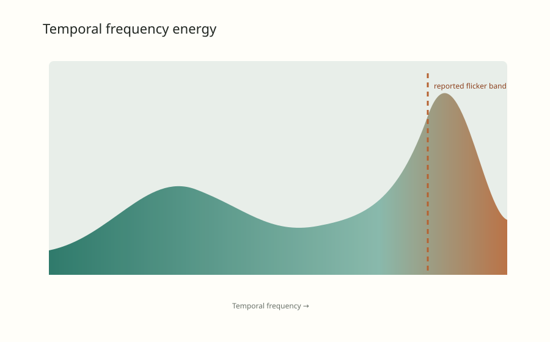
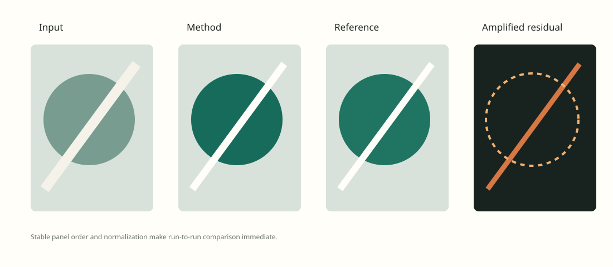

```python exec hide
trace = read_json(REPORT_ROOT / "media" / "interactive.plotly.json")
proposed, reference = trace["data"][0]["y"], trace["data"][1]["y"]
cases = read_csv(REPORT_ROOT / "media" / "cases.csv")
stable = sum(row["stable"] == "true" for row in cases)
unstable = len(cases) - stable
gain = 1 - proposed[-1] / reference[-1]
```

## Abstract

<!--
Abstract: a self-contained summary of the question, approach, principal result,
important qualification, and current decision. The front matter `summary` is a
shorter version of this for the overview; update both together.
-->

This feasibility study asks whether adding local smoothness improves lattice
reconstruction relative to data-only fitting. The proposed method lowers final
residual while preserving most evaluated cases, but a high-frequency failure is
not yet perceptually calibrated. The evidence supports continued diagnosis, not
parameter tuning.

```python exec hide
metric("Proposed final residual", proposed[-1], f"{gain:.0%} lower than the reference over the full trace", fmt=".3f")
metric("Stable evaluated cases", f"{stable} / {len(cases)}", f"{unstable} edge cases remain unresolved")
metric("Feasibility verdict", "Promising", "Proposed local fitting; not yet tuned")
```

## Introduction

<!--
Introduction: link to the project target in the overview
(report:overview#introduction) instead of restating it, then state what this
direction contributes to it: its research question, scope, motivation, and why
this comparison matters for the shared target.
-->

Within the [project target](report:overview#introduction), this direction
evaluates whether a localized regularizer improves edge alignment
without introducing unacceptable temporal artifacts. It is deliberately bounded
to representative and edge cases so the method can pass a feasibility gate
before systematic tuning.

## Background and related work

<!--
Background and related work: fill from a literature and prior-art search (a
research subagent when available), with linked sources and links to related
direction reports. Flag any existing version of the idea in a `prior-art`
callout and say what remains new. Then define every method, baseline, and
variant in a table whose first column is `Method` (What it does / Difference
from baseline / Held constant) before results use their names.
-->

Gradient-penalty smoothness is a standard regularizer (Tikhonov regularization;
total-variation methods are its edge-preserving relative). This study tests only
whether applying it *locally near boundaries* helps lattice reconstruction.

!!! prior-art "Close prior work: spatially adaptive regularization"
    Spatially varying regularization weights are well established in image
    reconstruction. This example treats the idea as a replication target, not
    a novel contribution. In a real project, cite the closest sources here with
    links, and state what (if anything) the proposed variant adds.

The reference and proposed method use the same evidence and evaluation. The
comparison isolates one modeling change:

| Method | What it does | Difference from baseline | Held constant |
| --- | --- | --- | --- |
| Reference | Fits the data term without local smoothness | Baseline | Inputs, initialization, optimizer, and evaluation |
| Local fitting (proposed) | Adds a local smoothness penalty near boundaries | Adds $\lambda \lVert \nabla \theta \rVert_2^2$ | Inputs, initialization, optimizer, and evaluation |

## Methods

<!--
Methods: the proposed method, experimental design, data, protocol, fairness
boundary (data and split, seeds, budget, initialization, optimizer, stopping,
evaluation), confounded contrasts, and which contrast supports each causal
claim. Use a Graphviz diagram for data flow when prose is not enough.
-->

The proposed objective is

$$
L(\theta) = L_{data}(\theta) + \lambda \lVert \nabla \theta \rVert_2^2.
$$

This research direction lives in `reports/<slug>/`; its `report.md` is the
narrative source, and every number below is computed from files. The overview
lists it with the front matter `summary`, and other reports link here with
`report:<slug>#anchor`. Rendered blocks retain
their source line, so comments point back here even as the report evolves.

```dot id=fig-pipeline title="Feasibility pipeline" caption="Graphviz lays out the nodes; the build embeds a static SVG."
digraph {
  rankdir=LR
  config [label="Hydra config"]
  run [label="Experiment run"]
  outputs [label="outputs/<name>/latest"]
  report [label="report.md"]
  comments [label="Comments"]
  config -> run -> outputs -> report -> comments
  comments -> config [style=dashed label="revise"]
}
```

## Findings

<!--
Results and discussion sections (Findings, Diagnostics, ... as the question
needs): `!!! finding <status>` blocks for decision-relevant claims only, with
a qualitative title (no result numbers: the finding id comes from the title) and
numbers from run files via {{ }} in the body; supporting figures taken from the runs that
wrote them; contradictions and limitations stated plainly. Arrange by research
question, not by the chronology of runs.
-->

!!! finding supported "Local fitting improves edge alignment"
    The method ends at a residual of {{ proposed[-1]:.3f }}, against
    {{ reference[-1]:.3f }} for the reference. The high-frequency failure
    remains visible in {{ unstable }} of {{ len(cases) }} cases.

    Sources: `media/interactive.plotly.json`, `media/cases.csv` · Reviewed 2026-10-12

!!! finding tentative "Temporal stability needs calibration"
    The spectral diagnostic detects the reported flicker, but its perceptual
    threshold is not calibrated yet.

    Sources: `media/spectrum.svg` · Reviewed 2026-10-12

!!! question "Synchronization needed"
    Confirm whether the remaining high-frequency artifact is acceptable before
    the project proceeds from feasibility testing to parameter tuning.

## Diagnostics

{#fig-residual}
{#fig-spectrum}
{#fig-grid}
{#fig-interactive}

```python exec hide
import matplotlib.pyplot as plt

figure = plt.figure(figsize=(7.2, 3.2), num="boundary-residual")
plt.scatter([float(r["reference_residual"]) for r in cases], [float(r["boundary_residual"]) for r in cases],
            c=["#176b5b" if r["stable"] == "true" else "#b56231" for r in cases])
plt.xlabel("Reference residual")
plt.ylabel("Method residual")
plt.title("Boundary residual per case")
```

## Evidence tables

Tables are plain Markdown (GitHub-style pipe tables):

| Question | Evidence | Status |
| --- | --- | --- |
| Does the method beat the reference on representative cases? | Residual trace, image grid | supported |
| Is the remaining high-frequency artifact acceptable? | Temporal spectrum | open |
| Do the two unresolved edge cases share a cause? | Not yet inspected | open |

Use HTML only where Markdown cannot express the content. A short `html raw`
fence is inserted as is:

```html raw
<p class="callout">Short HTML snippets may stay inline. Anything larger lives in its own file.</p>
```

Larger HTML blocks, such as layouts Markdown cannot express, live in
`reports/fragments/` and are referenced by path:

```html include
fragments/side-by-side.html
```

## Conclusion

<!--
Conclusion: the answer the current evidence supports, its limits, and the next
decision or experiment. Mirror it in the front matter `summary` and, if it
changes the project's direction, in the overview's Status section.
-->

Local fitting is promising because it reduces the measured residual relative to
the reference, but the unresolved temporal artifact prevents a tuning decision.
The next work should:

1. Calibrate the temporal score with pairwise judgments.
2. Test the {{ unstable }} unresolved edge cases.
3. Do not begin tuning until the feasibility review is confirmed.
