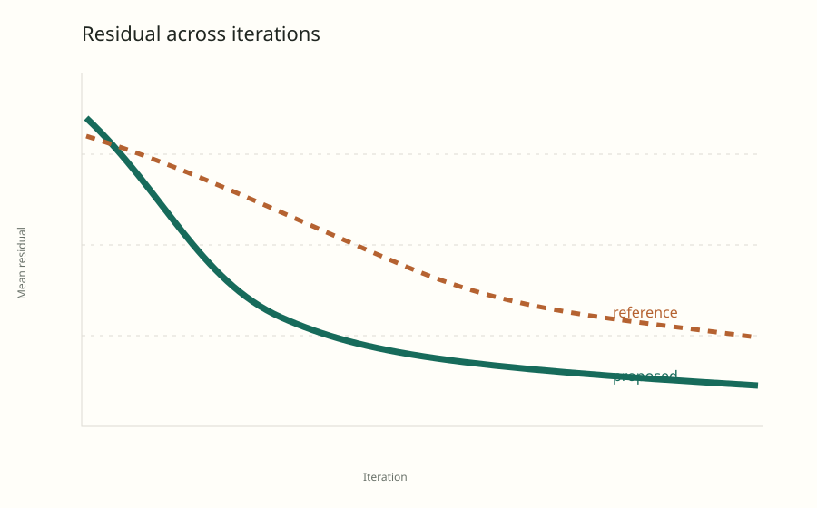

```python exec hide
trace = read_json(REPORT_ROOT / "assets" / "interactive.plotly.json")
proposed, reference = trace["data"][0]["y"], trace["data"][1]["y"]
cases = read_csv(REPORT_ROOT / "assets" / "cases.csv")
stable = sum(row["stable"] == "true" for row in cases)
unstable = len(cases) - stable
gain = 1 - proposed[-1] / reference[-1]
```

## Abstract

<!--
Abstract: a self-contained summary of the question, approach, principal result,
important qualification, and current decision. The front matter `summary` is a
shorter version of this for the overview; update both together.
-->

This feasibility study asks whether adding local smoothness improves lattice
reconstruction relative to data-only fitting. The proposed method lowers final
residual while preserving most evaluated cases, but a high-frequency failure is
not yet perceptually calibrated. The evidence supports continued diagnosis, not
parameter tuning.

```python exec hide
metric("Proposed final residual", proposed[-1], f"{gain:.0%} lower than the reference over the full trace", fmt=".3f")
metric("Stable evaluated cases", f"{stable} / {len(cases)}", f"{unstable} edge cases remain unresolved")
metric("Feasibility verdict", "Promising", "Proposed local fitting; not yet tuned")
```

## Introduction

<!--
Introduction: link to the project target in the overview
(report:/#introduction) instead of restating it, then state what this
direction contributes to it: its research question, scope, motivation, and why
this comparison matters for the shared target.
-->

Within the [project target](report:/#introduction), this direction
evaluates whether a localized regularizer improves edge alignment
without introducing unacceptable temporal artifacts. It is deliberately bounded
to representative and edge cases so the method can pass a feasibility gate
before systematic tuning.

## Background and related work

<!--
Background and related work: fill from a literature and prior-art search (a
research subagent when available), with linked sources and links to related
direction reports. Flag any existing version of the idea in a `prior-art`
callout and say what remains new. Then define every method, baseline, and
variant in a table whose first column is `Method` (What it does / Difference
from baseline / Held constant) before results use their names.
-->

Gradient-penalty smoothness is a standard regularizer (Tikhonov regularization;
total-variation methods are its edge-preserving relative). This study tests only
whether applying it *locally near boundaries* helps lattice reconstruction.

!!! prior-art "Close prior work: spatially adaptive regularization"
    Spatially varying regularization weights are well established in image
    reconstruction. This example treats the idea as a replication target, not
    a novel contribution. In a real project, cite the closest sources here with
    links, and state what (if anything) the proposed variant adds.

The reference and proposed method use the same evidence and evaluation. The
comparison isolates one modeling change:

| Method | What it does | Difference from baseline | Held constant |
| --- | --- | --- | --- |
| Reference | Fits the data term without local smoothness | Baseline | Inputs, initialization, optimizer, and evaluation |
| Local fitting (proposed) | Adds a local smoothness penalty near boundaries | Adds $\lambda \lVert \nabla \theta \rVert_2^2$ | Inputs, initialization, optimizer, and evaluation |

## Methods

<!--
Methods: a paper-ready explanation of the method, then the experimental design.
A reader who knows the field but not this project must be able to understand
what the method does, why it should work, and reimplement it from this section
alone. Keep the six subsections below, define every symbol once, explain every
term of every equation in words, and illustrate each non-obvious concept with a
figure computed from the project's own code. The report check fails when the
subsections are missing, Methods has fewer than 400 words, no display equation
or algorithm, or fewer than two figures.
-->

### Problem setup

<!--
Problem setup: inputs, outputs, unknowns, and notation. Every symbol used later
is defined here, once.
-->

We observe a noisy lattice $y \in \mathbb{R}^{n}$ (one value per site) and want
the clean lattice $\theta \in \mathbb{R}^{n}$. A known binary mask
$m \in \{0, 1\}^{n-1}$ marks the neighbouring site pairs that lie near a
boundary; $D \in \mathbb{R}^{(n-1) \times n}$ is the forward-difference
operator, so $(D\theta)_i = \theta_{i+1} - \theta_i$, and $M = \mathrm{diag}(m)$.
Reconstruction quality is the boundary residual: the error of $\theta$ against
the reference, measured only on masked sites.

### Method

<!--
Method: the method step by step with its equations; explain what every term
does, why it is there, and what changes without it. Add an algorithm when the
method is iterative or has stages.
-->

The proposed method minimises

$$
L(\theta) = \lVert \theta - y \rVert_2^2 + \lambda \lVert M D \theta \rVert_2^2 .
$$

The first term, the data term, keeps $\theta$ close to the observations; alone
it returns $\theta = y$, noise included. The second term penalises differences
between neighbouring sites, but only where $m$ is one: near boundaries it pulls
neighbours together and removes noise, elsewhere it does nothing, so detail away
from boundaries is untouched. The weight $\lambda \geq 0$ trades the two:
$\lambda = 0$ is the data-only reference, and large $\lambda$ flattens the
masked region. Because both terms are quadratic, the minimiser solves one
linear system:

1. Build $D$ and $M$ from the lattice size and the boundary mask.
2. Form $A = I + \lambda D^{\top} M D$, which is symmetric and positive
   definite for every $\lambda \geq 0$.
3. Solve $A \theta = y$ (a sparse Cholesky factorisation for large lattices).

The figure below shows the effect on a one-dimensional slice. Outside the masked
band the fit equals the data. Inside it the noise is removed, but the step at
the boundary is smeared over the band as well: the penalty cannot tell noise
from a real jump, which is the failure discussed under "Why it works".

```python exec hide
# In a project, import the method from its own code here (for example
# `from reconstruction.local import solve`) instead of re-implementing it, so
# the figure shows what the code does. The sample has no project code.
import numpy as np
import matplotlib.pyplot as plt

rng = np.random.default_rng(0)
x = np.linspace(0, 1, 120)
clean = np.where(x < 0.5, 0.2, 0.8)
y = clean + rng.normal(0, 0.06, x.size)
mask = (np.abs(x[:-1] - 0.5) < 0.18).astype(float)
D = np.diff(np.eye(x.size), axis=0)
theta = np.linalg.solve(np.eye(x.size) + 25.0 * D.T @ np.diag(mask) @ D, y)

figure, axis = plt.subplots(figsize=(7, 2.8), num="masked-smoothing")
axis.axvspan(0.32, 0.68, color="#dcebe5", label="masked band (m = 1)")
axis.plot(x, y, ".", color="#9aa59e", markersize=3, label="observations y (= data-only fit)")
axis.plot(x, theta, color="#176b5b", linewidth=2, label="proposed θ")
axis.plot(x, clean, "--", color="#202621", linewidth=1, label="clean lattice")
axis.set(xlabel="site position", ylabel="value", title="Masked smoothing on a 1-D slice")
axis.legend(fontsize=7, loc="upper left", frameon=False)
```

### Why it works

<!--
Why it works: intuition, assumptions, and where the method should fail; tie
each assumption to the finding or experiment that tests it.
-->

Noise near boundaries is independent between neighbouring sites, while the
clean lattice varies slowly inside the masked band; penalising neighbour
differences there removes the first and keeps the second. The method assumes
that the mask is correct and that the band is narrow relative to the structure
it protects. A boundary that falls inside the band is blurred, which is the
failure the edge-case finding tracks, and a mask that misses a boundary leaves
its noise in place.

### Relation to the baselines

<!--
Relation to the baselines: each baseline in the same notation, so every
difference is one term, step, or setting.
-->

The graph maps each term of the objective to the variables it depends on. Both
methods fit the lattice θ to the observations y through the same data term; the
proposed method adds only the smoothness term, which reads θ inside the
boundary mask m. Any difference between the two methods therefore comes from
the masked region.

```dot id=fig-model title="The model as a graph" caption="Variables are ellipses, objective terms boxes; the dashed term is the only addition of the proposed method."
digraph {
  rankdir=LR
  node [shape=ellipse]
  y [label="y (observations)"]
  theta [label="θ (lattice)"]
  m [label="m (boundary mask)"]
  node [shape=box]
  data [label="L_data(θ; y)"]
  smooth [label="λ‖MDθ‖²" style=dashed]
  loss [label="L(θ)"]
  y -> data; theta -> data; theta -> smooth; m -> smooth
  data -> loss; smooth -> loss [label="proposed only"]
}
```

### Implementation

<!--
Implementation: choices that affect results (discretization, initialization,
how hyperparameters were chosen, numerical safeguards, cost).
-->

The linear system is solved directly, so there is no initialisation or stopping
rule to tune. The weight $\lambda$ is chosen on a held-out validation lattice,
never on the evaluated cases; the mask is computed from the reference geometry
and is identical for both methods. The cost is one sparse factorisation per
lattice.

### Experimental design

<!--
Experimental design: data and split, seeds, budget, protocol, the fairness
boundary, and the contrast behind each causal claim.
-->

Both methods run on the same twenty evaluated cases with the same observations,
mask, and evaluation; the only difference is $\lambda$ (zero for the reference),
so the contrast between them isolates the smoothness term. This research
direction lives in `reports/<slug>/`; every number below is computed from files.

## Findings

<!--
Results and discussion sections (Findings, Diagnostics, ... as the question
needs): `!!! finding <status>` blocks for decision-relevant claims only, with
a qualitative title (no result numbers: the finding id comes from the title) and
numbers from run files via {{ }} in the body; supporting figures taken from the runs that
wrote them; contradictions and limitations stated plainly. Arrange by research
question, not by the chronology of runs.
-->

!!! finding supported "Local fitting improves edge alignment"
    The method ends at a residual of {{ proposed[-1]:.3f }}, against
    {{ reference[-1]:.3f }} for the reference. The high-frequency failure
    remains visible in {{ unstable }} of {{ len(cases) }} cases.

    Sources: `assets/interactive.plotly.json`, `assets/cases.csv` · Reviewed 2026-10-12

!!! finding tentative "Temporal stability needs calibration"
    The spectral diagnostic detects the reported flicker, but its perceptual
    threshold is not calibrated yet.

    Sources: `assets/spectrum.svg` · Reviewed 2026-10-12

!!! question "Synchronization needed"
    Confirm whether the remaining high-frequency artifact is acceptable before
    the project proceeds from feasibility testing to parameter tuning.

## Diagnostics

{#fig-residual}
{#fig-spectrum}
{#fig-grid}
{#fig-interactive}

```python exec hide
import matplotlib.pyplot as plt

figure = plt.figure(figsize=(7.2, 3.2), num="boundary-residual")
plt.scatter([float(r["reference_residual"]) for r in cases], [float(r["boundary_residual"]) for r in cases],
            c=["#176b5b" if r["stable"] == "true" else "#b56231" for r in cases])
plt.xlabel("Reference residual")
plt.ylabel("Method residual")
plt.title("Boundary residual per case")
```

## Evidence tables

Tables are plain Markdown (GitHub-style pipe tables):

| Question | Evidence | Status |
| --- | --- | --- |
| Does the method beat the reference on representative cases? | Residual trace, image grid | supported |
| Is the remaining high-frequency artifact acceptable? | Temporal spectrum | open |
| Do the two unresolved edge cases share a cause? | Not yet inspected | open |

Use HTML only where Markdown cannot express the content. A short `html raw`
fence is inserted as is:

```html raw
<p class="callout">Short HTML snippets may stay inline. Anything larger lives in its own file.</p>
```

Larger HTML blocks, such as layouts Markdown cannot express, live in
the report's `assets/` and are referenced by path:

```html include
assets/side-by-side.html
```

## Conclusion

<!--
Conclusion: the answer the current evidence supports, its limits, and the next
decision or experiment. Mirror it in the front matter `summary` and, if it
changes the project's direction, in the overview's Status section.
-->

Local fitting is promising because it reduces the measured residual relative to
the reference, but the unresolved temporal artifact prevents a tuning decision.
The next work should:

1. Calibrate the temporal score with pairwise judgments.
2. Test the {{ unstable }} unresolved edge cases.
3. Do not begin tuning until the feasibility review is confirmed.
