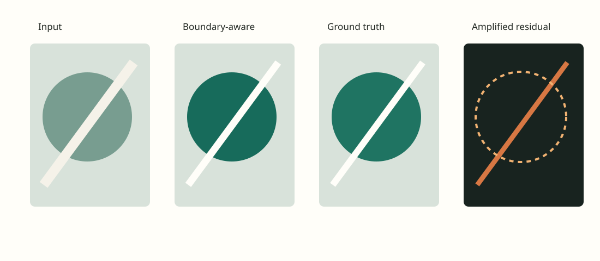

<!--
This sample direction exercises every report component. Replace its content,
summary, and assets/ with the direction's own material; keep the spine
(Abstract first, Conclusion last). How to write each section is in the skill's
references/writing-methods.md, with a worked Methods example in
references/example-methods.md.
-->

```python exec hide
import statistics

trace = read_json(REPORT_ROOT / "assets" / "interactive.plotly.json")
proposed, baseline = trace["data"][0]["y"], trace["data"][1]["y"]
cases = read_csv(REPORT_ROOT / "assets" / "cases.csv")
ours = [float(row["boundary_residual"]) for row in cases]
theirs = [float(row["global_residual"]) for row in cases]
stable = sum(row["stable"] == "true" for row in cases)
unstable = len(cases) - stable
wins = sum(a < b for a, b in zip(ours, theirs))
gain = 1 - proposed[-1] / baseline[-1]
quartiles = statistics.quantiles(ours, n=4)
```

## Abstract

<!--
Abstract: a self-contained summary of the question, approach, principal result,
important qualification, and current decision. The front matter `summary` is a
shorter version of this for the overview; update both together.
-->

Smoothing a noisy lattice removes noise but blurs its boundaries. This
feasibility study tests the classic remedy, a smoothness penalty that skips the
neighbour pairs crossing a boundary, against smoothing everywhere. With the
boundaries taken from the ground truth, it lowers the reconstruction error near
boundaries in {{ wins }} of {{ len(cases) }} synthetic sequences, but
{{ unstable }} sequences flicker in a way the evaluation cannot yet score
reliably, so the method is not ready for tuning. Whether the gain survives
estimated boundaries is untested.

```python exec hide
metric("Boundary residual, boundary-aware smoothing", proposed[-1], f"{gain:.0%} lower than global smoothing; lower is better; mean over {len(cases)} sequences", fmt=".3f")
metric("Sequences without flicker", f"{stable} / {len(cases)}", "flicker-band energy at most that of global smoothing")
```

## Introduction

<!--
Introduction: link to the project target in the overview
(report:/#introduction) instead of restating it, then state what this
direction contributes to it: its research question, scope, motivation, and why
this comparison matters for the shared target.
-->

Global smoothing is the standard way to suppress noise, and it fails the
[project target](report:/#introduction) where the target is strictest: it blurs
boundaries. This direction asks how much of that error disappears when the
smoothing knows where the boundaries are. It uses the true boundaries, so the
answer is an upper bound on what boundary-aware smoothing can gain, measured on
a bounded set of representative and edge-case sequences before any parameter
study.

## Background and related work

<!--
Background and related work: fill from a literature and prior-art search (a
research subagent when available), with linked sources and links to related
direction reports. Flag any existing version of the idea in a `prior-art`
callout and say what remains new. Then define every method, baseline, and
variant in a table whose first column is `Method` before results use their
names.
-->

A quadratic penalty on differences between neighbouring values is Tikhonov
regularization. Stopping the smoothing at edges is the idea of the line process
of [Geman and Geman (1984)](https://doi.org/10.1109/TPAMI.1984.4767596), which
infers binary boundary variables that switch the smoothness term off, and of
the anisotropic diffusion of
[Perona and Malik (1990)](https://doi.org/10.1109/34.56205), which lowers the
diffusion coefficient where the gradient is large.

!!! prior-art "Close prior work: line processes and edge-stopping diffusion"
    Both papers already smooth within regions and not across boundaries. This
    direction is a replication on lattice sequences with known boundaries; what
    it adds is the measurement of flicker, which per-image methods do not
    consider.

| Method | What it does | Difference from global smoothing | Held constant |
| --- | --- | --- | --- |
| Global smoothing | Penalizes the difference across every neighbour pair | Baseline | Observations, $\lambda$, solver, evaluation |
| Boundary-aware smoothing (proposed) | Penalizes the difference across every neighbour pair except those crossing a boundary | Boundary pairs unpenalized | Observations, $\lambda$, solver, evaluation |

## Methods

<!--
Methods: the method as implemented, then the experimental design, to the
standard of a good paper in the field: problem and notation first, the method
stated as equations or an algorithm, why it should work, the baselines in the
same notation, the settings that matter, and the design. Use the figures a paper
would have, computed with the project's own code.
-->

### Problem

Each sequence has $T$ frames. In frame $t$ we observe a noisy lattice
$y_t = \theta^\star_t + \varepsilon_t \in \mathbb{R}^{n}$ (one value per site),
where $\theta^\star_t$ is the ground truth, piecewise smooth with known
boundaries, and $\varepsilon_t$ is independent Gaussian noise of standard
deviation $\sigma$. Each frame is reconstructed separately. A frame is an $H \times W$
grid with $n = HW$ sites, and its neighbour pairs $P$ are the horizontally and
vertically adjacent sites. $D \in \mathbb{R}^{|P| \times n}$ has one row per
pair $(i, j)$, $(D\theta)_{(i,j)} = \theta_j - \theta_i$, and the mask $m \in
\{0, 1\}^{|P|}$ is $0$ for the pairs that cross a boundary and $1$ for all
others; $M = \mathrm{diag}(m)$.

### Boundary-aware smoothing

The reconstruction of a frame minimizes

$$
L(\theta) = \lVert \theta - y \rVert_2^2 + \lambda \lVert M D \theta \rVert_2^2 ,
$$

with weight $\lambda > 0$. The data term keeps $\theta$ close to the
observations; the penalty pulls neighbouring values together. Because the mask
removes exactly the pairs that cross a boundary, the two sides of a boundary are
smoothed independently and the step between them stays sharp. Global smoothing
is the same objective with $M = I$. Both terms are quadratic, so the minimizer
solves $(I + \lambda D^{\top} M D)\,\theta = y$, a symmetric positive definite
system, by conjugate gradients from $\theta = y$ until the relative residual is
below $10^{-6}$.

```python exec hide
# In a project, import the method from its own code here (for example
# `from reconstruction.smoothing import solve`) instead of re-implementing it,
# so the figure shows what the code does. The sample has no project code.
import numpy as np
import matplotlib.pyplot as plt

rng = np.random.default_rng(0)
x = np.linspace(0, 1, 120)
clean = np.where(x < 0.5, 0.2, 0.8)
y = clean + rng.normal(0, 0.06, x.size)
D = np.diff(np.eye(x.size), axis=0)
crossing = np.abs(np.diff(clean)) > 0
solve = lambda mask: np.linalg.solve(np.eye(x.size) + 25.0 * D.T @ np.diag(mask) @ D, y)

figure, axis = plt.subplots(figsize=(7, 2.8), num="boundary-aware-smoothing")
axis.plot(x, y, ".", color="#9aa59e", markersize=3, label="observations y")
axis.plot(x, solve(np.ones(x.size - 1)), color="#b56231", linewidth=1.5, label="global smoothing")
axis.plot(x, solve((~crossing).astype(float)), color="#176b5b", linewidth=2, label="boundary-aware smoothing")
axis.plot(x, clean, "--", color="#202621", linewidth=1, label="ground truth θ*")
axis.set(xlabel="site position", ylabel="value", title="Smoothing across a boundary on a 1-D slice")
axis.legend(fontsize=7, loc="upper left", frameon=False)
caption("With the same λ, global smoothing spreads the step over many sites; skipping the one pair that crosses the boundary keeps it sharp while removing the noise on both sides.")
```

The figure shows the difference on a one-dimensional slice with a single
boundary: away from the boundary the two methods agree, and at the boundary
only global smoothing spreads the step.

### Why it should work

Inside a region the ground truth varies slowly while the noise is independent
between neighbours, so penalizing neighbour differences removes mostly noise.
Across a boundary the difference is mostly signal, and penalizing it is what
blurs the step; leaving those pairs out removes the blur without giving up the
denoising. The argument assumes that the mask is right: a missed boundary is
blurred as under global smoothing, and a spurious one leaves its pair noisy.
The sample uses the true boundaries, so it measures the gain when this
assumption holds. Each frame is reconstructed separately, so independent
noise in consecutive frames leaves slightly different reconstructions; this
is the possible source of flicker, measured below.

### Experimental design

The {{ len(cases) }} evaluated sequences come from one synthetic generator:
$64 \times 64$ frames, $T = 32$ frames per sequence, two to five polygonal
regions per sequence, each with a linear ramp inside, whose boundaries move by
at most one site per frame, and noise with $\sigma = 0.06$; every sequence has
its own seed. Four of them are edge cases with regions narrower than three
sites, where the smoothing has little within-region support. Both methods use
the same $\lambda = 25$, chosen from $\{1, 3, 10, 25, 50, 100\}$ by the
boundary residual of global smoothing on a held-out validation sequence, so the
comparison isolates the mask and, if anything, favours the baseline. Two measures are reported for
each sequence:

1. The **boundary residual**: the root-mean-square of $\theta_t - \theta^\star_t$
   over the sites adjacent to a boundary, averaged over frames.
2. **Flicker**: the energy of the temporal spectrum of $\theta_t -
   \theta^\star_t$ in the upper quarter of temporal frequencies, averaged over
   sites. A sequence counts as stable when this energy is at most that of global
   smoothing.

## Findings

<!--
Results and discussion sections (Findings, Diagnostics, ... as the question
needs): `!!! finding <status>` blocks for decision-relevant claims only, with
a qualitative title (no result numbers: the finding id comes from the title) and
numbers from run files via {{ }} in the body; supporting figures taken from the
runs that wrote them; contradictions and limitations stated plainly.
-->

!!! finding supported "Boundary-aware smoothing lowers the boundary residual"
    With the true boundaries, the mean boundary residual is
    {{ proposed[-1]:.3f }} against {{ baseline[-1]:.3f }} for global smoothing,
    {{ gain:.0% }} lower; per sequence it is lower in {{ wins }} of
    {{ len(cases) }} sequences, with an interquartile range of
    {{ quartiles[0]:.3f }}–{{ quartiles[2]:.3f }} (scatter plot in
    [Diagnostics](#diagnostics)).

    Sources: `assets/cases.csv` · Reviewed 2026-10-14

!!! finding tentative "Flicker remains in some sequences"
    {{ unstable }} sequences have more flicker-band energy than global
    smoothing. Whether that energy is visible has not been calibrated against
    viewers, so the stability count may over- or understate the problem.

    Sources: `assets/spectrum.svg`, `assets/cases.csv` · Reviewed 2026-10-14

!!! question "Is the remaining flicker acceptable?"
    Confirm whether the flicker in the unstable sequences is acceptable before
    the project moves from feasibility to parameter tuning.

## Diagnostics

The scatter plot backs the first finding and the temporal spectrum the second.

{#fig-grid}
{#fig-spectrum}
{#fig-interactive}

```python exec hide
import matplotlib.pyplot as plt

figure = plt.figure(figsize=(7.2, 3.2), num="boundary-residual")
plt.scatter(theirs, ours, c=["#176b5b" if r["stable"] == "true" else "#b56231" for r in cases])
limit = max(theirs + ours) * 1.05
plt.plot([0, limit], [0, limit], color="#9aa59e", linewidth=1)
plt.xlabel("Boundary residual, global smoothing")
plt.ylabel("Boundary residual, boundary-aware")
plt.title("Boundary residual per sequence")
caption("Points below the diagonal gain from skipping boundary pairs; orange points flicker.")
```

## Limitations

The boundaries are taken from the ground truth, which a real application does
not have, so the measured gain is an upper bound; an estimated mask fails in
the two ways described in [Why it should work](#why-it-should-work).

## Conclusion

<!--
Conclusion: the answer the current evidence supports, its limits, and the next
decision or experiment. Mirror it in the front matter `summary` and, if it
changes the project's direction, in the overview's Status section.
-->

Skipping the neighbour pairs that cross a boundary lowers the boundary residual
compared with global smoothing when the boundaries are known. Two questions
remain before tuning:

1. Calibrate the flicker score with pairwise judgments, and inspect the
   {{ unstable }} unstable sequences for a shared cause.
2. Measure the gain with boundaries estimated from the observations, which
   decides whether the direction is worth pursuing.
